<picture><source media="(prefers-color-scheme: dark)" srcset="assets/hero-dark.svg"></picture>

  

<picture><source media="(prefers-color-scheme: dark)" srcset="assets/stack-dark.svg"></picture>

  

<a href="https://github.com/tofiqueadam/fidel"><picture><source media="(prefers-color-scheme: dark)" srcset="assets/fig-fidel-dark.svg"></picture></a>
<a href="https://github.com/tofiqueadam/memora-ai-telegram-bot"><picture><source media="(prefers-color-scheme: dark)" srcset="assets/fig-memora-dark.svg"></picture></a>

<a href="https://github.com/tofiqueadam/Antenna-Design-Project"><picture><source media="(prefers-color-scheme: dark)" srcset="assets/fig-antenna-dark.svg"></picture></a>
<a href="https://github.com/tofiqueadam/mango-disease-detect"><picture><source media="(prefers-color-scheme: dark)" srcset="assets/fig-leaf-dark.svg"></picture></a>

 

<picture><source media="(prefers-color-scheme: dark)" srcset="assets/footer-dark.svg"></picture>

