<picture><source media="(prefers-color-scheme: dark)" srcset="assets/hero-dark.svg"></picture> <picture><source media="(prefers-color-scheme: dark)" srcset="assets/stack-dark.svg"></picture> <a href="https://github.com/tofiqueadam/fidel"><picture><source media="(prefers-color-scheme: dark)" srcset="assets/fig-fidel-dark.svg"></picture></a><a href="https://github.com/tofiqueadam/tera-live"><picture><source media="(prefers-color-scheme: dark)" srcset="assets/fig-tera-dark.svg"></picture></a> <a href="https://github.com/tofiqueadam/overhead"><picture><source media="(prefers-color-scheme: dark)" srcset="assets/fig-overhead-dark.svg"></picture></a><picture><source media="(prefers-color-scheme: dark)" srcset="assets/fig-loan-dark.svg"></picture> <a href="https://github.com/tofiqueadam/memora-ai-telegram-bot"><picture><source media="(prefers-color-scheme: dark)" srcset="assets/fig-memora-dark.svg"></picture></a><a href="https://github.com/tofiqueadam/mango-disease-detect"><picture><source media="(prefers-color-scheme: dark)" srcset="assets/fig-leaf-dark.svg"></picture></a> <picture><source media="(prefers-color-scheme: dark)" srcset="assets/footer-dark.svg"></picture>

