<div align="center">
  
</div>

<div align="center">
  <code>⚡ [ SYSTEM: ACTIVE ]</code> &nbsp;•&nbsp;
  <code>🧠 [ AGENTIC_AI: ENABLED ]</code> &nbsp;•&nbsp;
  <code>🛡️ [ ARCHITECTURE: DISTRIBUTED ]</code> &nbsp;•&nbsp;
  <code>🚀 [ AVAILABILITY: 99.99% ]</code>
</div>

<br/>

<p align="center">
  
</p>

<br/>

```python
class SystemArchitect:
    def __init__(self):
        self.name = "Tofique"
        self.role = "Full Stack & AI Systems Engineer"
        self.focus = ["Distributed Systems", "Applied AI & LLMs", "Clean Architecture"]
        self.principles = {
            "clarity": "Make the complex intuitive, never convoluted.",
            "resilience": "Engineer for fault tolerance and deterministic state.",
            "craft": "Write software humans love to read and machines love to execute."
        }
```

---

### 🛠️ Core Engineering Stack

#### 🌐 Languages


#### ⚡ Frameworks & Platforms


#### 🗄️ Infrastructure & DevOps


<br/>

<div align="center">
  
</div>
